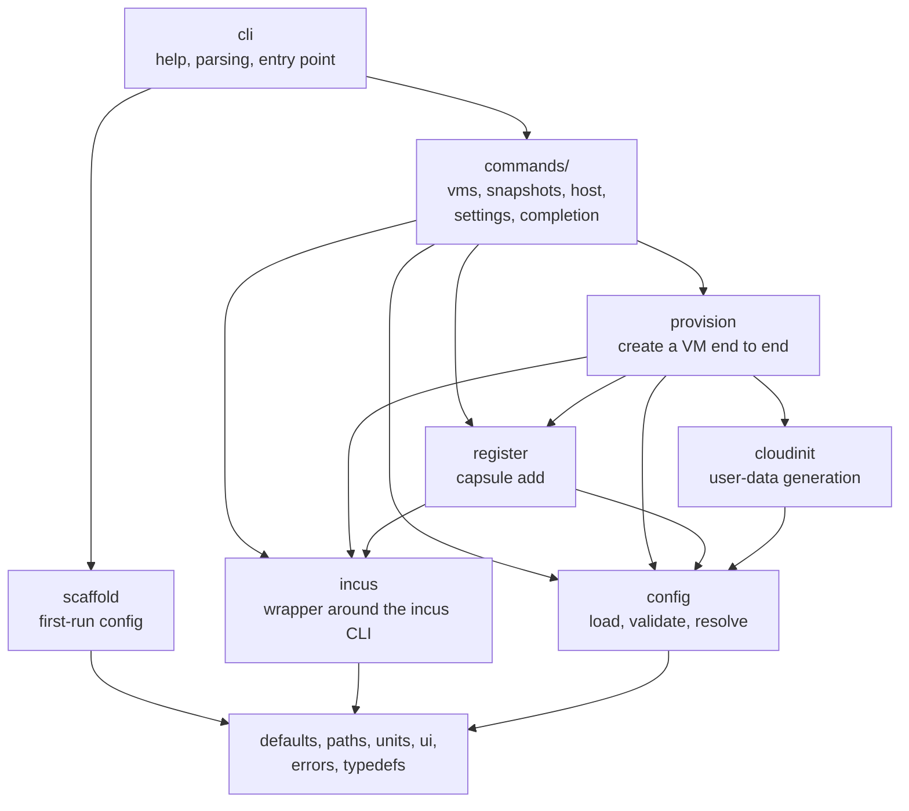
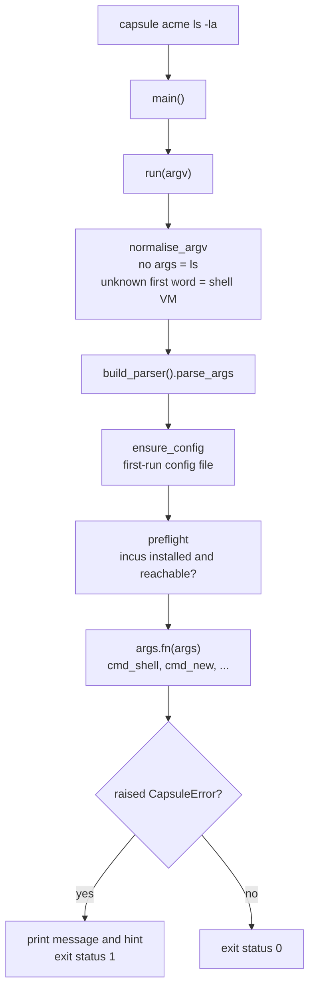
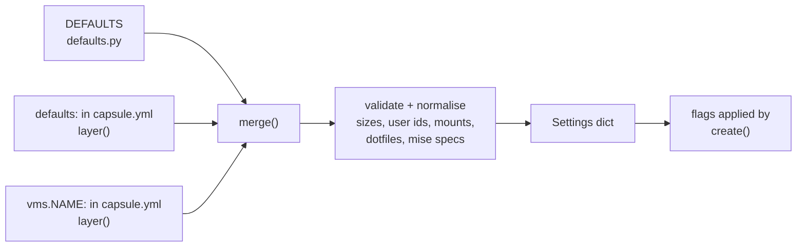
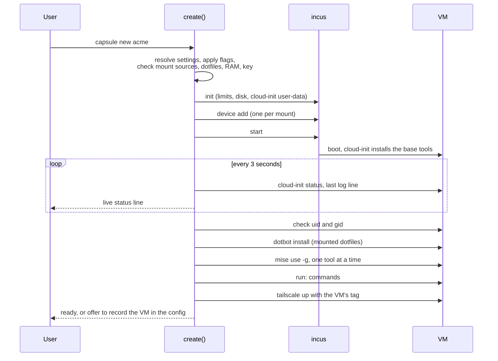
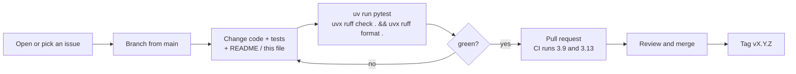

# Contributing to capsule

This is the developer guide: how the code is organised, why it is built this way, and how to make a change. For using capsule, read [README.md](README.md).

## Quick start

```bash
git clone <repository URL> && cd capsule
uv sync                          # creates .venv with the dev tools
uv run pytest                    # unit tests, no Incus needed
uvx ruff check . && uvx ruff format --check .
CAPSULE_CONFIG=/tmp/c.yml uv run capsule config acme     # try the CLI against a scratch config
```

Requirements: [uv](https://docs.astral.sh/uv/). Python 3.9 or newer is supported (CI runs 3.9 and 3.13), so do not use syntax newer than 3.9 at runtime. `from __future__ import annotations` is on in every module, so `int | None` in annotations is fine.

Capsule only really runs on a Linux host with Incus. On a Mac you can edit, test and run everything that does not call `incus` (`config`, `acl`, `help`, `completion`). Everything else is covered by tests that use a fake `incus` executable.

## Architecture

Capsule is one Python package, `src/capsule/`, split by responsibility. Lower layers never import higher ones.



| Module | Responsibility | Talks to the outside world? |
|---|---|---|
| `errors` | `CapsuleError` and `die()`: every user-facing failure | no |
| `paths` | `config_path()` and XDG directories | environment only |
| `defaults` | Built-in defaults and shared constants (`DEFAULTS`, `SIZES`, `COMMANDS`, ...) | no |
| `units` | `size()`, `to_mib()`, `host_mem_mib()` | reads `/proc/meminfo` |
| `ui` | Colours, `step()`, `warn()`, `confirm()`, `ask()` | terminal |
| `typedefs` | `Settings` and `Mount` types | no |
| `config` | Load `capsule.yml`, validate, merge layers, `resolve(name)` | reads the config file |
| `scaffold` | The commented starter config and `ensure_config()` | writes the config file |
| `incus` | `incus()` subprocess wrapper, `exists`, `instances`, `as_user`, ... | runs `incus` |
| `cloudinit` | `user_data(settings)`: the cloud-config that provisions a VM | no |
| `provision` | `create()` and `provision()`: the whole creation pipeline | runs `incus`, reads key files |
| `register` | `add_to_config()`: record a VM in `capsule.yml` | reads and writes the config file |
| `commands/*` | One function per subcommand, `cmd_<name>(args)` | via the modules above |
| `cli` | `HELP`, `build_parser()`, `normalise_argv()`, `run()`, `main()` | argv, exit status |

### One command, from argv to exit status



### Effective settings: one place decides

Every command asks `config.resolve(name)` for a VM's settings. Nothing else reads `capsule.yml` to decide what a VM looks like. This keeps `capsule config <vm>` honest: it prints exactly what `capsule new` will use.



`layer()` accepts the friendly forms (`ram` for `memory`, `size: small`, `user: dev:1500`, mounts as strings, `mise` as a mapping) and rejects unknown keys. `merge()` merges mappings, concatenates `packages`/`mise`/`run`, and replaces everything else.

### Creating a VM

`provision.create()` is the longest pipeline. Anything that fails raises `CapsuleError`; once the VM exists, a failure keeps it for inspection and says how to remove it.



## Architecture decision records

Short records of the decisions that shape the code. If you want to change one, open an issue first and propose a new record that supersedes it.

### ADR 1: One VM per project, on Incus
**Context.** Customer projects must not share ports, services or code unless asked. Containers share a kernel, Docker-only setups give the agent `docker.sock`, Vagrant is heavier, Proxmox replaces the OS, cloud servers you do not own can read your VM memory.
**Decision.** Incus VMs (KVM) on the existing Linux host, reached over Tailscale.
**Consequences.** A real kernel and network stack per project, and two projects can both use port 3000. Costs: RAM and disk per VM, and an Incus install on the host.

### ADR 2: A single CLI configured by one strictly validated YAML file
**Context.** Per-VM CPU, RAM, user, mounts and tools must be configurable without editing code.
**Decision.** `~/.config/capsule.yml` with `defaults:` and `vms:`; unknown keys are errors with a "did you mean" hint; `capsule config <vm>` shows the result. The file is created on first run.
**Consequences.** A typo never silently falls back to a default. New settings need a schema entry in `defaults.py` and validation in `config.py`.

### ADR 3: Python, distributed with uv
**Context.** The tool mostly shells out to `incus`, so raw speed is irrelevant; install and update must be easy. Bash cannot merge and validate YAML sanely.
**Decision.** A Python 3.9+ package (`capsule-vm`, command `capsule`) installed with `uv tool install`, PyYAML as the only dependency.
**Consequences.** One command to install and upgrade, isolated from system Python. A standalone binary would need a rewrite (for example in Go) or PyInstaller; not planned.

### ADR 4: Provision each VM with cloud-init; no template or clone
**Context.** Templates drift, need cleanup (machine-id, host keys, Tailscale state) and a rebuild step.
**Decision.** `images:debian/13/cloud` plus generated cloud-init user-data at every `capsule new`.
**Consequences.** Always current, nothing to maintain; the price is a few minutes per VM. `capsule rebuild` replaces a VM from the config.

### ADR 5: The VM user is a copy of the host user
**Context.** virtiofs does not remap ids, so a different uid or gid gives wrong ownership on every mounted file.
**Decision.** Default the VM user to the host user's name, uid and gid; allow overrides; warn on ids below 1000 and verify the gid after boot.
**Consequences.** Mounted files "just work". Ids in the system range can collide with groups in the image, which is why the warning exists.

### ADR 6: Mounts are opt-in; the dotfiles folder is derived from the script path
**Context.** A mounted folder is writable from inside the VM, so any agent there can change it.
**Decision.** No mounts by default. `dotfiles:` is the path of a dotbot install script; its folder is mounted from the host (nothing is cloned or fetched) and the script runs once. No separate folder setting.
**Consequences.** Isolation by default, and dotfile edits on the host show up in the VM at once. The dotfiles mount is re-added even if the user declines the others.

### ADR 7: Tools come from mise, installed globally
**Context.** One declarative list is easier to review than per-tool installers.
**Decision.** `mise:` entries run as `mise use -g -y <tool>`, one at a time; failures only warn. herdr itself is installed this way.
**Consequences.** Per-project versions stay in each project's `mise.toml`. If the user's dotfiles symlink mise's config, the tool list is written into the dotfiles repo.

### ADR 8: Tailscale for access; the ACL is printed, never pushed
**Context.** Pushing a policy needs an API token and overwrites the whole tailnet policy.
**Decision.** Each VM joins with its own `tag:cust-<name>`; `capsule acl` prints a fragment generated from the config for the user to merge by hand.
**Consequences.** Safe by construction, one manual step.

### ADR 9: Failures are exceptions, not `sys.exit`
**Context.** Calling `sys.exit` deep in the code made flows untestable and cleanup awkward (for example "keep the half-built VM").
**Decision.** Everything user-facing raises `CapsuleError(message, hint)` through `die()`. Only `cli.main()` prints it and sets the exit status.
**Consequences.** Tests use `pytest.raises(CapsuleError)`; `create()`, `rebuild` and `add_to_config()` can catch, clean up or roll back and re-raise. Messages should carry the fix in the hint.

### ADR 10: `capsule add` edits the config as text
**Context.** Round-tripping YAML loses the user's comments, and the starter file is mostly comments. A comment-preserving parser (ruamel.yaml) is a heavy dependency.
**Decision.** Insert a one-line flow entry under `vms:` with line-based logic, validate the result, and roll the file back if it no longer resolves.
**Consequences.** Layout and comments survive. It refuses an inline `vms: {...}` that already has entries and says what to add by hand.

### ADR 11: Warnings, not blocks, for resources
**Decision.** RAM over the host budget, ids in the system range, a missing Tailscale key: warn (and ask in an interactive session). Never refuse, because the user knows their machine.

### ADR 12: Test without Incus
**Decision.** Pure logic (config, cloud-init, add) is unit-tested directly. Flows that call `incus` run against a fake `incus` script put first on `PATH` (see `tests/conftest.py`); tests assert on the recorded calls.
**Consequences.** CI needs no virtualisation. What is not covered is Incus's real behaviour; the README's first-run checklist exists for that.

### ADR 13: No secrets management
**Decision.** capsule stores no secrets. The Tailscale key is read from a file or `$TS_AUTHKEY` and passed to the VM through a mode-0600 temporary file that is deleted afterwards. Agents log in inside each VM.

### ADR 14: The config file is versioned
**Context.** The config format will change, and silently misreading an old or newer file is worse than stopping.
**Decision.** An optional top-level `version:` key (missing means 1). `config.check_version` rejects non-integers, stops with "upgrade capsule" when the file is newer than `CONFIG_VERSION`, and upgrades older files in memory through the `MIGRATIONS` table. The file on disk is never rewritten.
**Consequences.** Format changes are explicit and testable. A breaking change means: bump `CONFIG_VERSION`, add a migration, test it, and mention it in the release notes.

### ADR 15: Host support is Debian 13+ and Ubuntu 24.04+ (apt), checked with a warning
**Context.** Only those releases package `incus` and `virtiofsd` in their own repositories; the VM image is Debian 13 whatever the host.
**Decision.** `host.host_os_problem()` reads `/etc/os-release`; derivatives (`ID_LIKE` debian/ubuntu) pass without a version check. `setup` and `doctor` warn on anything else and carry on.
**Consequences.** Other distributions are not blocked but not supported (setup is apt-only). Real hosts remain untested except Pop!_OS 24.04.

## Development process



### Conventions

- **Style:** `ruff format` (line length 120) and `ruff check` with the rules in `pyproject.toml` (pycodestyle, pyflakes, isort, pyupgrade, bugbear, simplify, comprehensions, pytest style). CI-equivalent locally: `uvx ruff check . && uvx ruff format --check .`.
- **Layout:** a function belongs to the lowest module that can host it. Commands are thin: parse arguments, call the lower layers, print. Business logic does not live in `commands/`.
- **Errors:** raise `die("what went wrong", "how to fix it")`. Never call `sys.exit` outside `cli.main()`. Never print a traceback for a user mistake.
- **Output:** use `step()`, `warn()`, `confirm()`, `ask()` from `ui`. Print results to stdout and problems to stderr. Interactive prompts only when `sys.stdin.isatty()`, so scripts never hang.
- **Typing:** annotate new functions; `Settings` and `Mount` live in `typedefs`.
- **Docs:** user-visible behaviour goes in README.md (keep its Mermaid diagrams valid), design choices in an ADR above.
- **Commits:** imperative subject line, one logical change each. Tests with the change.

### Recipes

**Add a command**

1. Write `cmd_<name>(args)` in the matching `commands/` module (or a new one).
2. Add the name to `COMMANDS` in `defaults.py`, register the subparser in `cli.build_parser()`, add a line to `HELP`. `test_every_command_name_is_a_subcommand_and_vice_versa` fails until all three agree.
3. If it needs no Incus, add it to `NO_INCUS_NEEDED` in `cli.py`; if it must not create the config file, to `NO_CONFIG_FILE`.
4. Add a test, and a row in the README command reference.

**Add a setting**

1. Add the key and its default to `DEFAULTS` in `defaults.py` (add it to `ADDITIVE` if lists should add up).
2. Accept shorthands in `config.layer()` and validate in `config.resolve()`.
3. Use it where needed (`cloudinit.user_data`, `provision.provision`, ...), and teach `register.config_entry()` to record it if it can differ per VM.
4. Add it to `scaffold.sample()` as a commented hint, to the README settings table, and to `tests/test_config.py`.

**Change what a VM gets at first boot**

Edit `cloudinit.user_data()` (apt packages, base tools, files). Anything per-user or order-dependent (dotfiles, mise, `run:`) belongs in `provision.provision()` instead, because it needs the finished VM.

**Change the config format (rare)**

Prefer adding an optional setting, which needs no version change. For a breaking change: bump `CONFIG_VERSION` in `defaults.py`, add `{old_version: migrate_function}` to `MIGRATIONS` in `config.py` (it receives and returns the raw config dict without the `version` key), update `scaffold.sample()` and the README, and test the migration (see `test_older_formats_are_migrated_in_memory`).

### Testing

| Kind | Where | Notes |
|---|---|---|
| Config (incl. format version, starter file), cloud-init, add | `tests/test_config.py`, `test_cloudinit.py`, `test_register.py`, `test_units.py` | Pure functions; the `cfg` fixture points `CAPSULE_CONFIG` at a scratch file |
| CLI wiring | `tests/test_cli.py` | Parser and command list stay in sync; errors become message, hint and exit status 1 |
| Creation flow | `tests/test_provision.py` | Runs `create()` against the fake `incus` and asserts on the recorded calls |

Two traps when testing: `cmd_shell` ends with `os.execvp`, which would replace the test process (stop earlier, or monkeypatch `os.execvp`); and the first run writes a config file, so always set `CAPSULE_CONFIG` (the `cfg` fixture does).

### Releasing

1. Update `version` in `pyproject.toml` and note the changes in the pull request description.
2. Merge, then tag `vX.Y.Z` on `main`.
3. `uv build` produces `dist/*.whl` and `dist/*.tar.gz`. Publish with `uv publish` once a package index is chosen; until then users install from git with `uv tool install git+<repository URL>`.

## Reporting problems

Include `capsule --help`'s version of the problem: your command, the message with its hint, your host OS and Incus version (`incus --version`), and the relevant part of `capsule config <vm>` (remove anything private).

## License

By contributing you agree that your work is released under the [MIT License](LICENSE).
