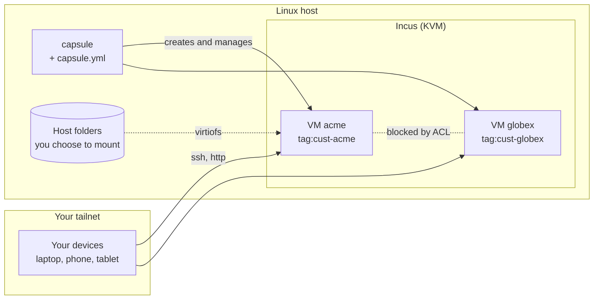
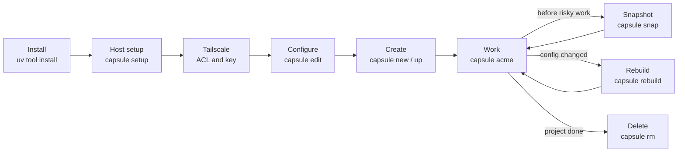
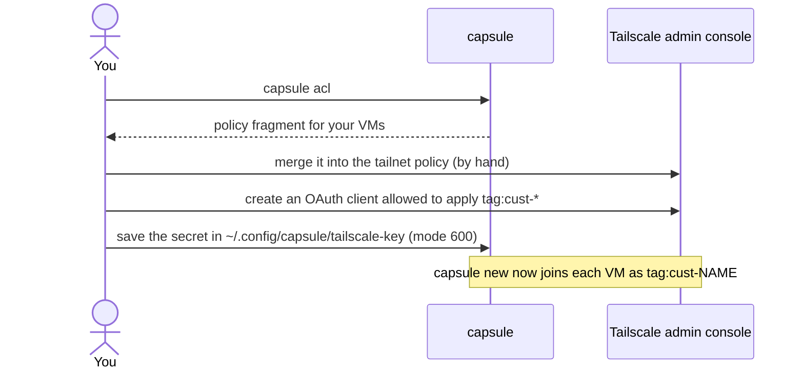
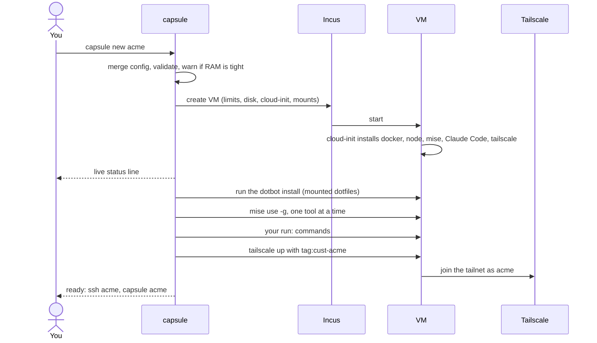
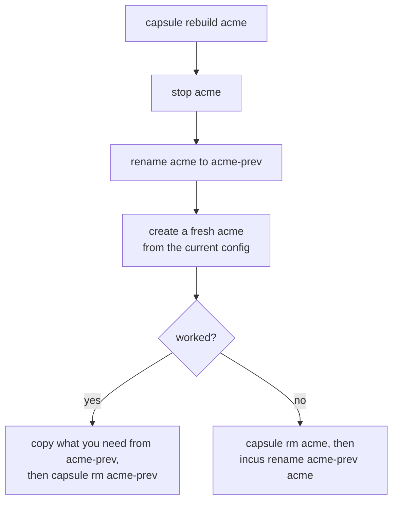
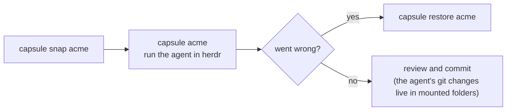
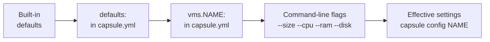

# capsule

**One Incus VM per project, configured by one YAML file.**


`capsule` creates, opens, snapshots, rebuilds and deletes isolated [Incus](https://linuxcontainers.org/incus/) virtual machines, one per customer or project, on a Linux machine you own. You work in them over SSH and [Tailscale](https://tailscale.com), with the [herdr](https://herdr.dev) terminal UI, and you can run AI coding agents inside a VM instead of on your host.

```console
$ capsule new            # answers a few questions, builds the VM, joins your tailnet
$ capsule acme           # opens a shell in it
$ capsule snap acme      # snapshot before something risky
```

> **Status: early (0.1).** The configuration and cloud-init logic are unit-tested without Incus, but the tool has not yet been verified end to end on real hardware. Expect rough edges on your first `capsule new` and see [Project status](#project-status). Issues and pull requests are welcome.

## Contents

- [Why capsule](#why-capsule) · [Features](#features) · [How it works](#how-it-works)
- [Requirements](#requirements) · [Installation](#installation) · [Quick start](#quick-start)
- [Usage](#usage): [create](#create-a-vm) · [work](#work-in-a-vm) · [snapshots and cleanup](#snapshots-rebuilds-and-cleanup) · [AI agents](#working-with-ai-agents)
- [Configuration](#configuration) · [Command reference](#command-reference) · [Troubleshooting](#troubleshooting)
- [Security model](#security-model-and-limitations) · [Updating and uninstalling](#updating-and-uninstalling)
- [Project status](#project-status) · [Contributing](#contributing) · [License](#license)

## Why capsule

When you juggle several customer projects on one machine, shared ports, shared tooling and shared credentials get messy, and an AI agent with a shell on your host can touch everything. Containers share a kernel, Docker-only setups hand out `docker.sock`, and heavier tools (Vagrant, Proxmox, Coder) need more than one person's laptop should carry.

capsule gives each project its own VM with its own kernel, network stack and Tailscale node, and keeps the day-to-day interface down to a handful of commands. Two projects can both run a dev server on port 3000, and an agent in one VM cannot reach another.

## Features

- **One command, instinctive:** `capsule acme` opens a shell, starting or creating the VM if needed. Typos suggest the right command.
- **Guided or declarative:** `capsule new` asks a few questions; `capsule up` builds every VM listed in your config.
- **Per-VM settings in one YAML file:** CPU, RAM (or `small`/`medium`/`large`), disk, user, mounts, apt packages, [mise](https://mise.jdx.dev) tools, dotfiles, Tailscale tag. Strict validation, with "did you mean" hints.
- **Safe by default:** nothing from your host is shared with a VM unless you list it; VMs cannot reach each other.
- **Your environment in every VM:** your user (same uid and gid, so mounted files keep their owner), your dotbot dotfiles mounted live from the host, your tools installed globally.
- **Snapshots, rebuilds and a doctor:** `snap` / `restore`, `rebuild` from the current config, and `doctor`, which prints the fix for every problem.
- **Reachable anywhere:** Tailscale SSH, `capsule open` for dev-server URLs and port forwarding.
- **Tab completion** for commands and VM names (bash and zsh).

## How it works



`capsule` is a thin, friendly layer over the `incus` command line. A VM is built from the Debian 13 cloud image with generated cloud-init, so there is no template to maintain. The lifecycle:



## Requirements

- A Linux host with hardware virtualisation (`kvm-ok` passes; enable VT-x/AMD-V in the firmware). Supported hosts: Debian 13+ and Ubuntu 24.04+, and derivatives (Pop!_OS, Mint, ...), all through apt. Developed on Pop!_OS 24.04; the other hosts are untested. `capsule setup` and `capsule doctor` warn on anything else but do not refuse. `sudo` must be installed (Debian's installer skips it when you set a root password).
- [uv](https://docs.astral.sh/uv/), which installs capsule and its one dependency (PyYAML) in an isolated environment. Python 3.9 or newer.
- No Docker on the host: its iptables rules break VM networking. (Docker inside VMs is fine.)
- A Tailscale account, with Tailscale on the host and on the devices you connect from. Optional: capsule works without it, VMs are then reachable only with `capsule <vm>` on the host.
- About 40 GB of free disk per VM (the default; `disk:` changes it) and RAM for the VMs you run at once.
- Your user's uid and gid become the VM user's, so files on mounts keep your ownership (virtiofs does not remap ids). Nothing to configure unless you want a different name.

## Installation

```bash
git clone <repository URL> && cd capsule
uv tool install .                # puts `capsule` on your PATH; later: uv tool upgrade capsule-vm
```

Once published you will be able to install straight from git: `uv tool install git+<repository URL>`.

**Set up the host (once).** `capsule setup` checks KVM, installs `incus` and `virtiofsd`, adds you to the `incus-admin` group, and creates the storage pool `default` and the bridge `incusbr0` (10.77.0.0/24). It uses sudo and is safe to re-run. Then **log out and in** so the group applies, and check that `incus list` works without sudo. If setup warns about Docker, remove Docker or apply the two iptables rules it prints.

**Connect Tailscale (once, optional but recommended).** Without it, `capsule new` still creates VMs but does not put them on your tailnet.



1. **ACL.** `capsule acl` prints a policy fragment built from the VMs in your config. Merge it into your tailnet policy by hand; never paste it over your policy. It lets your own devices reach every VM (`acls`), lets members log in to them with Tailscale SSH as the VM user (`ssh`; OpenSSH is disabled in the VMs), lets you apply each `tag:cust-<name>` (`tagOwners`, not needed with an OAuth client allowed to apply `tag:cust-*`), and gives no rule that lets a `tag:cust-*` node reach anything, so VMs are isolated from each other and from your devices. Add `tcp:<port>` destinations if you restrict ports, and run `capsule acl` again when you add VMs. capsule only prints the policy: pushing it would need an API token and overwrite your whole policy.
2. **Key.** Each VM joins with its own tag, so use an **OAuth client** allowed to apply `tag:cust-*` (a plain auth key can only apply the tags it was created with). Save its secret to `~/.config/capsule/tailscale-key` (mode 600) or export `$TS_AUTHKEY`.

**Optional: tab completion.** Add `eval "$(capsule completion)"` to `~/.bashrc`, or to `~/.zshrc` after `compinit` (`capsule completion zsh` forces the shell).

## Quick start

```bash
capsule doctor           # checks the host and config, and prints the fix for every problem
capsule new              # guided: name, size, folders to share; builds the VM in a few minutes
capsule acme             # opens herdr in the VM
ssh acme                 # from any device on your tailnet
```

The first command you run writes a commented starter config to `~/.config/capsule.yml` (see [Configuration](#configuration)). Everything has a sensible default, so you can ignore it until you need something different.

## Usage

### Create a VM

```bash
capsule new                       # guided: asks name, size and folders to share
capsule new acme --size large     # one line (--size, or --cpu 2 --ram 4GiB --disk 60GiB)
capsule up                        # create or start every VM listed under `vms:` in the config
capsule add acme                  # record a VM you created with flags in the config
```

`capsule new` has no template: each VM is provisioned from scratch, so it is always current and nothing is cloned. It takes a few minutes and shows a live status line with the elapsed time and the current install step. VM names are lowercase letters, digits and dashes, and cannot be a capsule command (`ls`, `new`, `rm`, ...), because `capsule <name>` opens the VM.



Before the long wait, `capsule new` checks for a Tailscale key and asks whether to continue without one. If the VM is not listed under `vms:` in your config it offers to add it, because `up` and `rebuild` build from the config, not from the flags you typed; `capsule add` does the same at any time (from the VM itself, or from `--size/--cpu/--ram/--disk`).

Failures never leave you guessing: a failed mise tool or dotfiles run only warns (the VM is still usable); a failed or interrupted provisioning stops, keeps the half-built VM so you can inspect it (`incus exec acme -- bash`, log at `/var/log/cloud-init-output.log`) and tells you to `capsule rm acme` and retry.

### Work in a VM

```bash
capsule acme                # open herdr in the VM. Starts it if stopped; offers to create it if it is in your config
capsule acme ls -la         # run one command instead (same as: capsule shell acme ls -la)
ssh acme                    # from any device on your tailnet (Tailscale SSH)
capsule open acme 3000      # URLs of a dev server in the VM, plus the ssh -L line
capsule ls                  # name, state, IP, CPU, RAM, last snapshot (also lists configured VMs not created yet)
capsule start|stop|restart acme [globex ...]
```

herdr here is the terminal UI from herdr.dev, not a desktop app. It keeps its sessions on the VM, so they survive SSH drops: detach with `ctrl+b q`, reattach by running `capsule acme` again. If the shell program is missing in the VM (say its mise install failed), `capsule acme` opens bash and tells you why instead of failing.

**What is inside a VM**

| Part | How it gets there |
|---|---|
| User, docker, node, devcontainers CLI, mise, Claude Code, Tailscale | cloud-init, at creation |
| `packages:` | apt, at creation |
| `mise:` tools (lazygit, herdr, oh-my-pi by default) | `mise use -g`, **global** for the VM user. Per-project versions stay in each project's own `mise.toml`, which overrides the global one. A tool that fails to install only warns |
| Dotfiles | your dotbot folder, mounted from the host (nothing is fetched or cloned), install script run once |
| `run:` commands | once, as the VM user, last |

**Mounts.** Nothing is shared by default, except the dotbot folder if you set `dotfiles`. List the folders you want under `mounts:`. Mounts are virtiofs devices, read-write unless you add `:ro`, and they survive `rebuild`.

**Dotfiles.** `dotfiles` is the host path of your dotbot install script, for example `~/dotfiles/install`; there is no separate folder setting, the folder is found from where the script lives. `capsule new` mounts that folder into the VM from the host (nothing is fetched with git) and runs the script once, as the VM user, from inside it. The mount stays and dotbot's symlinks point into it, so editing your dotfiles on the host changes the VM immediately. Re-run the script by hand only when you add new links: `capsule acme 'cd ~/dotfiles && ./install'`. Arguments go after the path (`dotfiles: ~/dots/install -c my.conf.yaml`). If the folder already sits inside a folder you mount, no second mount is added; if the folder or script does not exist, `new` warns and skips dotfiles.

**mise and your dotfiles.** If your dotfiles manage mise's global config through a symlink into the mounted dotbot folder, `mise use -g` writes the tool list into that file, which then shows up as a change in your dotfiles repo.

#### Ports and networking

Every VM is its own Tailscale node, so two VMs can both listen on port 3000 and you normally forward nothing. Bind dev servers to `0.0.0.0` (not `127.0.0.1`) inside the VM.

| Need | How |
|---|---|
| Open a dev server from any of your devices | `http://acme:3000` (MagicDNS name of the VM; `capsule open acme 3000` prints it). The ACL must allow the port if you restrict ports |
| Use it as `localhost:3000` (OAuth callbacks, localhost-only apps) | On another machine: `ssh -L 3000:localhost:3000 acme` (`capsule open` prints it). On the host itself: `capsule open acme 3000 --forward`, undone with `--unforward` |
| HTTPS inside the tailnet | in the VM: `tailscale serve --bg 3000` |
| Public URL (demo, webhook) | in the VM: `tailscale funnel 3000`. Needs the `funnel` node attribute in the ACL; keep it off by default and grant it per tag |
| From the host itself | `curl http://<ip>:3000`, using the IPv4 from `capsule ls` (bridge `incusbr0`) |
| Fixed port on the host's LAN | `incus config device add acme web proxy listen=tcp:0.0.0.0:8080 connect=tcp:127.0.0.1:3000`. Avoid it: it exposes the port to the whole LAN |

### Snapshots, rebuilds and cleanup

```bash
capsule snap acme         # snapshot before something risky (default name: pre-ai); replaces one of the same name
capsule snaps acme        # list snapshots
capsule restore acme      # roll back (asks first)
capsule rebuild acme      # recreate from the current config; the old VM is kept, stopped, as acme-prev
capsule rm acme           # delete the VM and all its data; shows what is lost, asks you to type the name (-y skips)
```

Snapshots cover the VM disk only, not mounted host folders (use git for those), and they live on the same disk as the VM, so they are not backups. Back up important VMs with `incus export acme acme.tar.gz`.

`rebuild` is how config changes (a new tool, more RAM, different mounts) reach an existing VM. Mounted folders are untouched.



It builds from the config, so a VM you created with flags and never listed under `vms:` comes back with the defaults; `rebuild` says so and shows any size change before asking (record it first with `capsule add acme`). It needs room for two disks until you delete the old one, and the new VM is a new Tailscale node, so remove the old node in the admin console. After `rm`, remove the VM's node there too.

**Capacity.** Each VM has a fixed RAM ceiling (8 GiB for `medium`). `capsule new` and `capsule doctor` warn when running VMs would exceed host RAM minus 4 GiB; nothing blocks. On a 24 GB host that is, for example, two `medium` VMs plus a `small`; use `size: small` and stop VMs you are not using. Check disk with `df -h /var/lib/incus`.

**Maintenance.** Tools are installed once, at creation, at the versions current then. Update a VM by running the changes inside it, or rebuild it.

### Working with AI agents

Claude Code is preinstalled in every VM and herdr comes from the default `mise:` list. Log in to Claude Code once per VM (`claude`). Run agents inside the VM, never on the host.



- **Snapshot first.** `capsule snap acme` before a risky run; `capsule restore acme` rolls the VM back. Mounted folders are not rolled back.
- **Git credentials.** Use per-repo deploy keys or fine-grained tokens created inside the VM. Do not forward your ssh-agent into it.
- **Isolation.** A VM cannot reach other VMs or your devices (ACL). It can change any folder you mounted into it, so mount only the customer's own folder.

## Configuration

The config is optional: with no file, built-in defaults apply. The first time you run any `capsule` command it writes `$XDG_CONFIG_HOME/capsule.yml` (normally `~/.config/capsule.yml`; `$CAPSULE_CONFIG` overrides the whole path), filled with your detected user and a sensible starting point. Open it with `capsule edit`; `capsule config acme` shows what a VM will actually get.

```yaml
version: 1                 # config format; if a newer capsule changes it, you are told how to upgrade

defaults:                  # applies to every VM
  size: medium             # small = 2 CPU/4GiB, medium = 4/8GiB, large = 8/16GiB. Or set cpu: and ram: yourself
  disk: 40GiB
  user: you:1000:1000      # name:uid:gid, detected from the user running capsule
  # dotfiles: ~/dotfiles/install   # your dotbot install script; its folder is mounted live and the script run once
  packages: [neovim, tig, btop]    # extra apt packages, added to the built-in ones
  mise:                            # tools installed globally in each VM (mise use -g); name@version, latest by default
    - lazygit@latest
    - herdr@latest                 # the default `shell`: keep it here, or change `shell:`
    - github:can1357/oh-my-pi@latest  # oh-my-pi (the `omp` command); no mise short name, so the github: backend

  # Everything below is optional and commented out in the generated file:
  # mounts:                # host folders shared into every VM (none by default)
  #   - ~/Code                              # same path in the VM (~ is the VM user's home there)
  #   - ~/Projects
  #   - ~/Docs:/mnt/docs:ro                 # src:dest[:ro]
  # tailscale: {key_file: ~/.config/capsule/tailscale-key, tag: "tag:cust-{name}"}   # or `tailscale: null`
  # run: ["npm i -g pnpm"]                  # commands run once in each new VM, as the VM user, after the mise tools
  # shell: herdr                            # what `capsule <vm>` runs
  # image: images:debian/13/cloud

vms:                       # one entry per customer VM; `capsule up` creates them all
  acme:
    size: small
  globex:
    mounts: [~/Code/globex]        # only this customer's code
    packages: [postgresql-client]
    mise: [node@22, python@3.13]   # added to the defaults
  initech:
    size: large
    user: dev:1000:1000
```



### Settings reference

| Setting | Default | Meaning |
|---|---|---|
| `version` | `1` | Config format version. A missing key means 1. A config from a newer format makes capsule stop and tell you to upgrade |
| `size` | `medium` | Preset for CPU and RAM: `small` 2 CPU/4 GiB, `medium` 4/8 GiB, `large` 8/16 GiB. An explicit `cpu` or `ram` in the same place wins |
| `cpu`, `ram` (alias `memory`) | 4, `8GiB` | Fixed ceilings. A bare number for `ram` means GiB |
| `disk` | `40GiB` | Root disk size |
| `user` | you (`name:uid:gid`) | VM user. `dev`, `dev:1500` and `dev:1500:1500` also work; missing ids default to yours |
| `mounts` | none | Host folders shared read-write into the VM, as `~/Code`, `src:dest[:ro]` or `{source, path, readonly}` |
| `dotfiles` | none | Host path of your dotbot install script (arguments allowed). The folder is whatever contains the script: it is mounted into the VM and the script run once. `null` skips |
| `packages` | `[]` | Extra apt packages, added to the built-in ones (git, docker.io, build-essential, curl, jq, nodejs, npm) |
| `mise` | `[]` | Tools installed globally with `mise use -g`, as `tool@version` (bare name means `latest`) |
| `run` | `[]` | Shell commands run once as the VM user, after the mise tools |
| `tailscale` | `key_file` + `tag` | Key location and tag template (`{name}` is the VM name). `null` skips |
| `shell` | `herdr` | What `capsule <vm>` runs |
| `image` | `images:debian/13/cloud` | Base image |

**Rules that keep it predictable**

- **Layers:** mappings (`user`, `dotfiles`, `tailscale`) merge key by key. `packages`, `mise` and `run` add up (defaults first, then the VM's; for `mise`, a tool listed again replaces the earlier version, so `lazygit@0.44.1` on a VM overrides the default `lazygit@latest`). `mounts` and other scalars replace.
- **Typos are errors:** `cpuu: 2` fails with "did you mean cpu?". A bad setting never silently falls back to a default.
- **Paths:** `~` and `$VARS` in host paths (mount `source`, the `dotfiles` script, `key_file`) mean your host; in a mount `path`, `~` is the VM user's home.
- **Applied at creation:** editing the config affects new VMs; apply it to an existing VM with [`capsule rebuild`](#snapshots-rebuilds-and-cleanup).
- **Comments survive:** `capsule add` appends a one-line entry under `vms:` and leaves the rest of the file alone.

### Environment variables

| Variable | Effect |
|---|---|
| `XDG_CONFIG_HOME` | Where the config lives: `$XDG_CONFIG_HOME/capsule.yml` (default `~/.config/capsule.yml`) and the default Tailscale key `$XDG_CONFIG_HOME/capsule/tailscale-key` |
| `CAPSULE_CONFIG` | Full path of the config file, overriding the above |
| `TS_AUTHKEY` | Tailscale key to use instead of the key file |
| `VISUAL`, `EDITOR` | Editor for `capsule edit` (falls back to `nano`) |

## Command reference

| Command | What it does |
|---|---|
| `capsule <vm>` | Open the shell command (herdr) in the VM; start it, or create it if it is defined in the config |
| `capsule new [vm]` | Create a VM; with no name it asks. `--size small\|medium\|large`, `--cpu`, `--ram`, `--disk` |
| `capsule up [vm...]` | Create or start the VMs defined under `vms:` |
| `capsule add <vm>` | Record a VM under `vms:` in the config, keeping the file's comments: from the VM itself (limits, disk, mounts, user) or from `--size/--cpu/--ram/--disk` |
| `capsule ls` | List VMs with state, IP, CPU, RAM and last snapshot |
| `capsule open <vm> [port]` | Print the URLs of a dev server and the `ssh -L` command (`--browser` opens it; `--forward` / `--unforward` map the port to the host's localhost) |
| `capsule start\|stop\|restart <vm...>` | Power |
| `capsule shell <vm> [cmd...]` | Run a command in the VM instead of the shell |
| `capsule snap <vm> [name]` / `snaps <vm>` / `restore <vm> [name]` | Snapshot, list, roll back |
| `capsule rebuild <vm>` | Recreate from the current config, keeping the old VM as `<vm>-prev` |
| `capsule rm <vm>` | Delete a VM and its data |
| `capsule doctor` | Check host, config and VMs, with a fix for each problem |
| `capsule config [vm]` / `edit` | Show the effective settings / edit the config file |
| `capsule setup` | One-time host setup |
| `capsule acl` | Print the Tailscale policy for your VMs |
| `capsule completion [bash\|zsh]` | Print a tab-completion script (shell detected from `$SHELL`) |

A typo like `capsule lss` suggests the closest command or VM name, and `capsule <command> --help` prints the command list.

## Troubleshooting

Start with `capsule doctor`.

| Symptom | Likely cause and fix |
|---|---|
| "do not run capsule as root" | Run it as your normal user. It calls sudo itself where needed (`capsule setup`) |
| "cannot talk to incus" | You are not in the `incus-admin` group yet: log out and in after `capsule setup` |
| `new` fails at "provisioning failed" | Read the log: `incus exec <name> -- cat /var/log/cloud-init-output.log`. Usually a package name or a curl-piped installer. Fix it in `src/capsule/cloudinit.py` (`user_data`), `capsule rm <name>` and retry |
| A mise tool "could not be installed" | The name is not in mise's registry (`mise registry <name>`) or the download failed. Use a backend such as `github:owner/repo@latest`; the VM works without it |
| VM has no network or no IPv4 in `ls` | Docker on the host sets the iptables FORWARD policy to DROP. Remove Docker from the host, or apply the iptables rules `capsule setup` prints |
| Mounted files show the wrong owner or group, or `nobody` | The VM user's uid/gid differs from yours, the gid collides with a system group in the image (host ids below 1000, such as 20 (dialout); `capsule new` and `doctor` warn: set `user.uid` and `user.gid` to 1000), or the mount is missing. Compare `id` on the host with `capsule config acme` and `incus config device show acme` |
| `ssh acme` fails | The VM is stopped or not on the tailnet. Start it, check `tailscale status` in the VM and the ACL `ssh` rule. Fallback that needs no Tailscale: `capsule acme` |
| `new` warned "not on your tailnet" | No Tailscale key. Set `tailscale.key_file` or `$TS_AUTHKEY`, then run in the VM `tailscale up --ssh --advertise-tags=tag:cust-acme --auth-key=...` |
| "config format version N, but this capsule understands up to M" | The config was written by a newer capsule: `uv tool upgrade capsule-vm` |

## Security model and limitations

Designed for one person's own machine, not a multi-tenant system. What it does and does not isolate:

| Isolated | Not isolated |
|---|---|
| Ports and services: each VM has its own network stack and Tailscale node | **Whatever you mount is read-write in that VM** (unless `:ro`), including your dotbot folder. If you mount all of `~/Code`, any VM, or an agent in it, can read or change every customer's code. Snapshots do not protect mounted folders, so use git |
| Kernel and processes: VMs, not containers | **Claude Code credentials live inside each VM.** Compromise of a VM exposes its login |
| Customer VMs cannot reach each other or your devices, if the ACL is applied as `capsule acl` prints it | The host's root user can read all VM disks and memory (acceptable on your own machine) |
| | Installers for mise, Claude Code and Tailscale are curl-piped, and mise tools are downloaded from their upstream releases, without a checksum |

Nothing is shared by default. Prefer one folder per customer (`mounts: [~/Code/acme]` under that VM) over mounting all of `~/Code`; add `:ro` for folders a VM should only read. To drop one mount from an existing VM: `incus config device remove acme <device>` (list them with `incus config device show acme`).

**Other limitations.** RAM and disk are fixed per VM (full disks, no copy-on-write on the default `dir` pool). Docker on the host breaks VM networking. If the host sleeps or loses power, every VM is unreachable (handle sleep in your host's power settings; herdr sessions survive reconnects). capsule manages no secrets: the Tailscale key comes from a file or `$TS_AUTHKEY`, and you log in to Claude Code inside each VM.

## Updating and uninstalling

- **Update capsule:** `uv tool upgrade capsule-vm` (or `uv tool install --reinstall .` from a clone). Running VMs are not affected; new VMs and rebuilds use the new code.
- **Remove one VM:** `capsule rm acme`, then remove its node in the Tailscale admin console.
- **Remove capsule:** `uv tool uninstall capsule-vm`. Your config (`~/.config/capsule.yml`) and your VMs stay until you delete them.
- **Undo the host setup:** `sudo gpasswd -d "$USER" incus-admin`, then reboot. To remove Incus entirely: delete the VMs first (`capsule rm ...`), then `sudo apt remove incus`.

## Project status

Early (0.1): unit-tested, not yet verified end to end on real hardware. If you try it first, this is the path and the likely failure points:

1. Install, `capsule setup`, log out and in.
2. Tailscale: OAuth client in `~/.config/capsule/tailscale-key` (`chmod 600`), merge the output of `capsule acl`.
3. `capsule doctor`, then `capsule new pilot`. Likely failure points: cloud-init (a package or installer URL), the gid created with `bootcmd`, the dotbot run, a mise tool.
4. From another device `ssh pilot`; run `claude` once to log in.

It works when `ssh pilot` works from a second device; `docker run hello-world`, `mise --version`, `devcontainer --version`, `claude --version`, `herdr --version` and `omp --version` work inside; two VMs can both bind port 3000; and a mounted folder is visible and writable with the right ownership.

**Not yet verified:** `capsule setup` on Debian 13 and Ubuntu 24.04+ hosts (only their package names were checked: `incus`, `virtiofsd` and `cpu-checker` exist in their repositories), that `herdr machine add <vm>` (one window across all VMs, over Tailscale SSH) works, and that `incus list -f json` returns `snapshots` (the last-snapshot column). **Possible hardening:** pin or checksum the downloaded installers.

## Contributing

Issues and pull requests are welcome. The architecture, the decision records, the conventions, how to add a command or a setting, and the release process are in [CONTRIBUTING.md](CONTRIBUTING.md).

```bash
git clone <repository URL> && cd capsule
uv sync && uv run pytest     # tests need no Incus
```

## License

MIT, see [LICENSE](LICENSE).
